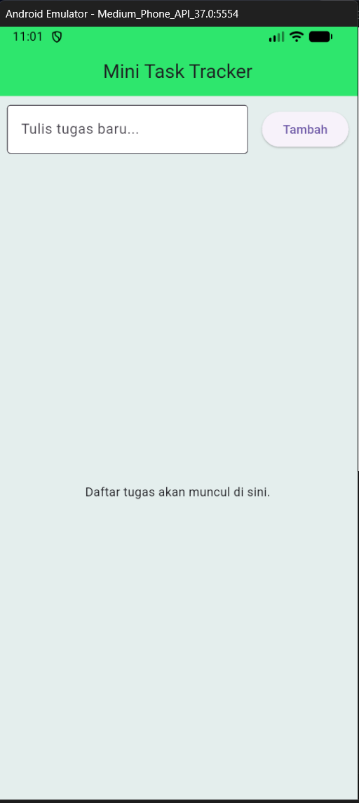
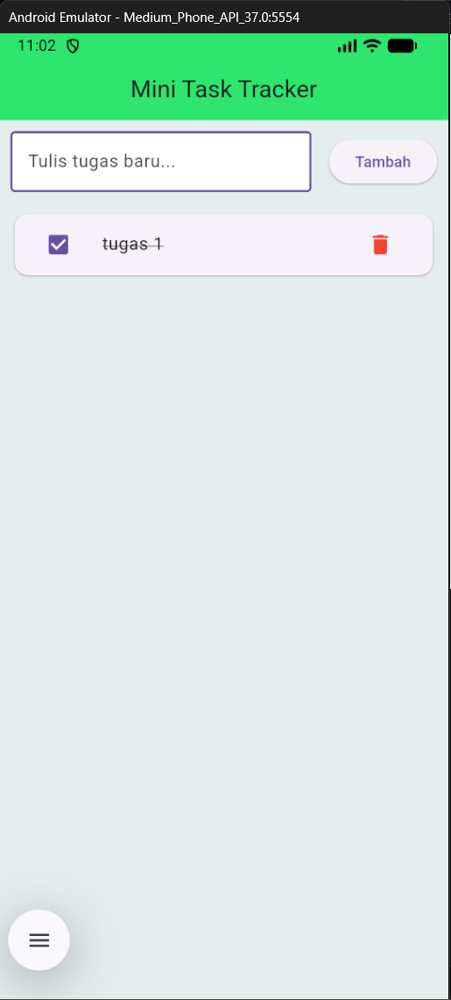

# Mini Task Tracker

Aplikasi pencatat tugas harian (*to-do list*) sederhana berbasis **Flutter** yang dibuat untuk memenuhi studi kasus pengembangan aplikasi mobile. Aplikasi ini mengelola daftar catatan secara dinamis di memori lokal menggunakan `StatefulWidget` dan `setState()`.

## Fitur Utama

- **Tambah Tugas**: Menambahkan item tugas baru ke dalam daftar dengan validasi input (`.trim()`) sehingga teks kosong atau spasi saja tidak tersimpan.
- **Tandai Selesai**: Menandai tugas yang telah dikerjakan menggunakan `Checkbox`, yang secara otomatis memberikan efek coret (*strikethrough*) pada teks judul tugas.
- **Hapus Tugas**: Menghapus item tugas tertentu dari daftar melalui tombol ikon hapus.
- **Antarmuka Dinamis**: Menampilkan pesan informasi otomatis saat daftar tugas masih dalam keadaan kosong.

## Tampilan Aplikasi

| Tampilan Awal | Tambah Tugas | Tandai Selesai | Hapus Tugas |
| :---: | :---: | :---: | :---: |
|  |  |  |  |

## Struktur Kode & Teknologi

- **Framework**: Flutter (Material Design 3)
- **Bahasa Pemrograman**: Dart
- **Manajemen State**: Local State (`StatefulWidget` & `setState`)
- **Arsitektur File (`lib/main.dart`)**:
  - `class Task`: Model struktur data untuk merepresentasikan satu item tugas (`String title` dan `bool isDone`).
  - `class MyApp` & `_MyAppState`: Mengelola antarmuka utama (`MaterialApp` & `Scaffold`), penyimpanan daftar tugas (`List<Task>`), pembaca input (`TextEditingController`), serta logika manipulasi data (`_addTask`, `_toggleTaskDone`, dan `_deleteTask`).

## Cara Menjalankan Proyek

1. **Clone repositori ini:**
   ```bash
   git clone [https://github.com/satriabbagaskara/mini_task_tracker.git](https://github.com/satriabbagaskara/mini_task_tracker.git)
   cd mini_task_tracker